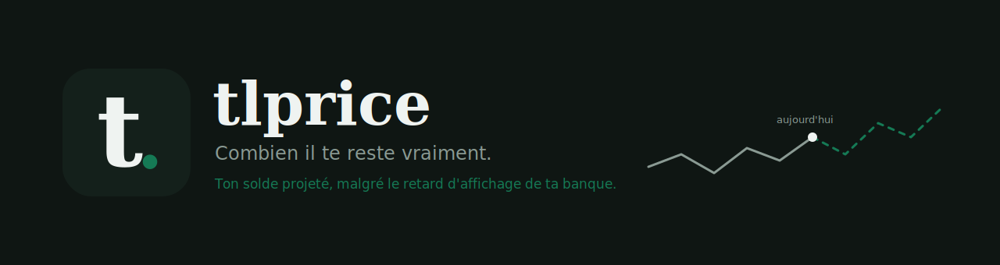
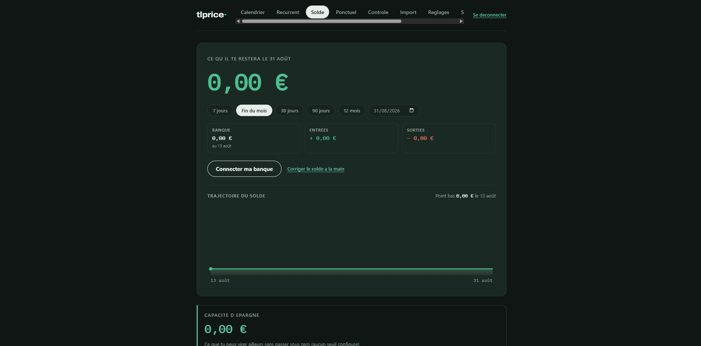
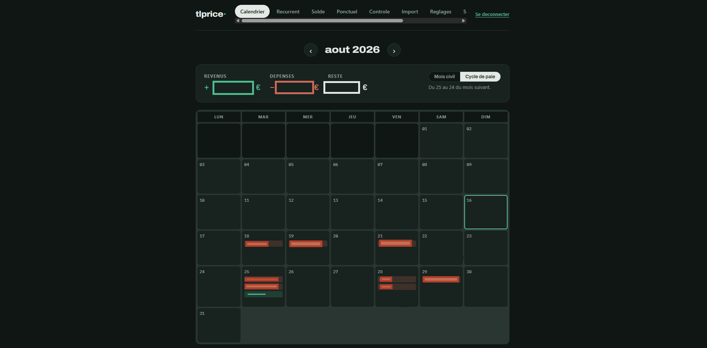
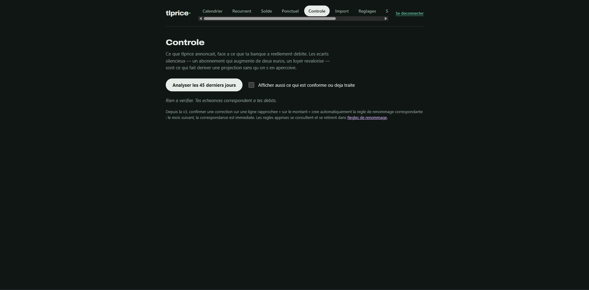
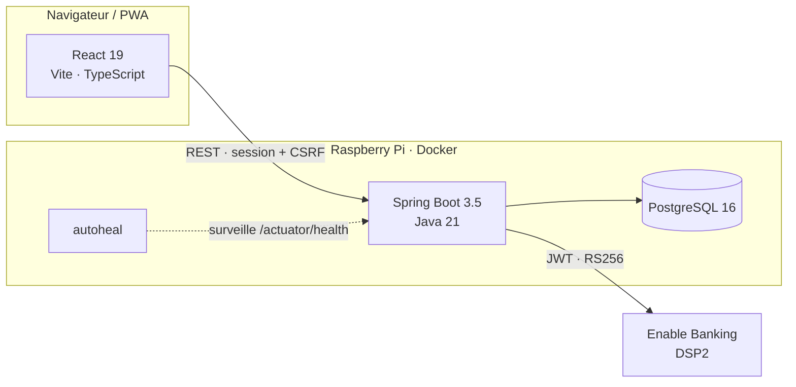

<p align="center">
  
</p>

<p align="center">
  
  
  
  
  
  
</p>

---

## Le problème

Ton application bancaire affiche **1 240 €**.

Sauf que le loyer part dans quatre jours, l'assurance dans six, et la carte du restaurant de samedi n'est toujours pas passée. Le vrai chiffre — celui qui répond à « est-ce que je peux me le permettre ? » — n'est écrit nulle part. Tu le recalcules de tête, plusieurs fois par semaine, et tu te trompes.

**tlprice existe pour afficher ce chiffre-là.**

## La réponse

```text
solde réel + crédits à venir − débits à venir − transactions pas encore débitées
```

Un chiffre, une date, et la liste de ce qui l'explique. Tout le reste de l'application sert à rendre ces quatre termes justes.

<br>

## Ce que ça fait

### 📊 La projection

Le solde à la date de ton choix — dans 7 jours, à la fin du mois, dans 12 mois.

Une courbe montre le passé constaté en trait plein et le futur projeté en pointillé, avec ton seuil d'alerte en repère. Les mouvements sont groupés par jour, avec le net de chaque journée.

### 📅 Le calendrier

Une vue mensuelle où chaque case affiche les prélèvements et le solde en fin de journée.

Un mode **cycle de paie**, du 25 au 24, est disponible parce que ton mois ne commence pas forcément le 1er. Chaque occurrence peut être ajustée ou annulée sans toucher à l'opération récurrente elle-même : le loyer augmente une fois, pas pour toujours.

### 🔍 Le contrôle

L'écart silencieux est ce qui fait dériver une projection : un abonnement qui prend deux euros, un loyer revalorisé.

tlprice confronte ce qu'il annonçait à ce que la banque a réellement débité, puis propose de corriger l'occurrence ou l'opération.

Il **apprend** également : confirmer un rapprochement incertain crée automatiquement la règle de renommage correspondante. Le mois suivant, `PRLV SEPA SCI DES TILLEULS 2024` est reconnu comme ton loyer sans que tu aies rien à faire.

### 🎲 Les scénarios

> Et si j'achète ça à 400 € le 12 ?

Un scénario est une liste de mouvements hypothétiques. Tu le sélectionnes sur l'écran Solde, et la projection l'intègre.

Le solde **sans le scénario** est affiché juste à côté, avec l'écart entre les deux. Les hypothèses ne sont jamais persistées comme des mouvements réels : elles disparaissent dès que tu les désélectionnes.

### 💰 La capacité d'épargne

Combien peux-tu virer sur ton livret sans passer sous ton seuil ?

Le raisonnement est affiché à côté du chiffre : on parcourt la période, on retient le solde le plus bas atteint, puis on retranche le seuil. C'est ce creux qui fixe la limite, pas le solde d'aujourd'hui.

Un montant seul serait un oracle ; avec le creux, tu peux le comprendre et le contester.

### 🔔 Les notifications

Un récapitulatif quotidien est envoyé par notification push iOS ou par email, précédé d'une synchronisation bancaire automatique.

Chaque appareil a **sa propre heure** : le téléphone à midi, l'ordinateur à 22 h.

### 🏦 La synchronisation bancaire

La synchronisation utilise Enable Banking, conformément à la directive DSP2.

Les identifiants bancaires ne transitent jamais par tlprice. Chaque clé privée est chiffrée en AES-256-GCM et ne donne accès qu'au compte de son propriétaire.

Sans banque compatible, l'application reste entièrement utilisable : le solde peut être corrigé manuellement et la projection fonctionne à l'identique.

<br>

## Pensé pour l'iPhone

Installée depuis l'écran d'accueil, tlprice se comporte comme une application native.

La barre du bas comporte cinq onglets, avec le solde au centre, sur le point le plus atteignable au pouce.

Il suffit de tirer vers le bas pour synchroniser. Les feuilles basses sont privilégiées aux fenêtres centrées, parce qu'une modale au milieu de l'écran demande au pouce de remonter.

Le calendrier utilise des points colorés. À 50 px de large, un libellé tronqué à trois lettres n'apprend rien. Un balayage horizontal permet de changer de mois.

<br>

## Captures

> Dépose tes captures dans `docs/captures/` sous ces noms et elles apparaîtront ici.

| Solde | Calendrier | Contrôle |
|:--:|:--:|:--:|
|  |  |  |

<br>

## Sous le capot



Architecture strictement en couches :

```text
entities → repositories → services → controllers
```

Le frontend est compilé puis servi par le backend : un seul conteneur, un seul port.

### Backend

Spring Boot 3.5, Java 21, Spring Security avec session, CSRF et cookie de connexion persistant, JPA/Hibernate, Apache POI pour l'export Excel, BouncyCastle pour le Web Push VAPID et AES-256-GCM pour les secrets en base.

### Frontend

React 19, Vite 8, TypeScript 5.9 et React Router 7.

Aucune bibliothèque de composants n'est utilisée. Le CSS est écrit à la main autour des polices Archivo et IBM Plex Mono.

### Infrastructure

Image Docker multi-étapes construite pour `linux/arm64`, tournant sur un Raspberry Pi 3B+ derrière un tunnel Cloudflare.

Un `HEALTHCHECK` surveille la sonde de vivacité, avec un conteneur `autoheal`.

Docker marque le conteneur comme `unhealthy`, mais ne le redémarre pas de lui-même sans mécanisme complémentaire.

<br>

## Installation

### Production

```bash
git clone https://github.com/<toi>/tlprice.git
cd tlprice

cp .env.example .env
# Puis remplis les variables nécessaires.
```

L'application écoute sur le port `8081`.

Mets un reverse proxy HTTPS devant l'application. HTTPS est obligatoire : Enable Banking refuse les URL de renvoi en clair et le Web Push ne fonctionne pas sans HTTPS.

Avec Caddy, deux lignes suffisent :

```text
tondomaine.fr {
    reverse_proxy localhost:8081
}
```

Génère les secrets ainsi :

```bash
openssl rand -base64 32
npx web-push generate-vapid-keys
```

La première commande génère `TLPRICE_CLE_CHIFFREMENT`. La seconde génère les variables `TLPRICE_VAPID_*`.

> ⚠️ La perte de `TLPRICE_CLE_CHIFFREMENT` rend les connexions bancaires et la configuration SMTP définitivement indéchiffrables.

### Raspberry Pi

Construis et publie l'image pour l'architecture ARM64 :

```bash
docker buildx build \
  --platform linux/arm64 \
  -t <compte>/tlprice:latest \
  --push .
```

Puis, sur le Raspberry Pi :

```bash
docker compose pull
docker compose up -d
```

Le script `scripts/verifier-prod.sh` contrôle la version en ligne, l'état de santé, les variables d'environnement et les sauvegardes.

### Développement

Backend :

```bash
cd backend
mvn spring-boot:run
```

Le backend utilise une base H2 locale et ne nécessite aucune configuration particulière pour démarrer.

Frontend :

```bash
cd frontend
npm install
npm run dev
```

Les variables locales vont dans `backend/.env`, lu automatiquement au démarrage.

Pour lancer les tests :

```bash
mvn test
```

<br>

## Sécurité et vie privée

Aucune donnée ne quitte ton serveur.

Il n'y a ni télémétrie, ni analytics, ni tiers, à l'exception de ta banque, à laquelle l'application parle directement via ton propre enregistrement Enable Banking.

Les clés privées bancaires et la configuration SMTP sont chiffrées en AES-256-GCM.

Le cookie de connexion est signé avec une clé dérivée de la clé maîtresse par SHA-256, jamais avec la clé maîtresse elle-même. Deux usages distincts méritent deux secrets distincts.

Les mots de passe sont hachés avec BCrypt.

Toutes les requêtes sont isolées par utilisateur au niveau du service.

Une sauvegarde JSON complète est écrite chaque nuit, en écriture atomique, avec une rotation sur 30 fichiers. Elle est téléchargeable depuis l'application.

<br>

## Feuille de route

- [ ] **Flyway** — migrations versionnées, avec `pg_dump -s` en référence de départ.
- [ ] **Multi-comptes** — courant, livret et compte joint, avec projection consolidée.
- [ ] **Import de fichier** — OFX et QIF, pour fonctionner avec n'importe quelle banque sans agrégateur.
- [ ] **Cloudflare Access** — à placer devant l'application pour limiter le bruteforce.
- [ ] **Tests** — notamment sur `SoldeService`.

<br>

## Licence

Projet personnel, publié pour consultation.

Aucune licence libre n'est accordée : tous droits réservés.

Ouvre une issue si tu veux en discuter.

<br>

<p align="center">
  <sub>Construit sur un Raspberry Pi 3B+, parce qu'il était déjà allumé.</sub>
</p>
